# 📑 Documento Oficial de Sustentación con Evidencias Visuales
## Plataforma Distribuida de Interoperabilidad Clínica (HSB - Red de IPS 3 Sedes)
**Asignatura:** Sistemas Distribuidos — Parcial Final  
**Estudiante:** José David Ortega Barrios  
**Entorno de Ejecución:** Linux Ubuntu (Docker + Python FastAPI + HAPI FHIR R4 + PostgreSQL)

---

## 🎯 Índice de Evidencias y Capturas por Fases

1. [Captura 1: Pruebas Automatizadas (30/30 Tests OK)](#captura-1-suite-completa-de-pruebas-unitarias-y-de-integración)
2. [Captura 2: Topología y Health Check de la Red Distribuida (Fase 1)](#captura-2-verificación-de-estado-y-topología-de-red-distribuida-health-check)
3. [Captura 3: Ingesta HL7 v2 y Normalización FHIR R4 (Fase 2)](#captura-3-ingesta-hl7-v2-adt-y-normalización-exitosa-a-hapi-fhir-r4)
4. [Captura 4: Idempotencia y Prevención de Duplicados (Fase 2)](#captura-4-garantía-de-idempotencia-y-prevención-de-registros-duplicados)
5. [Captura 5: Ingesta CSV Legado Sede 3 con Reglas de Negocio (Fase 2)](#captura-5-ingesta-de-archivos-csv-legados-con-validación-de-reglas-de-negocio)
6. [Captura 6: Consulta Federada de Historia Clínica Multisede (Fase 3)](#captura-6-consulta-federada-de-historia-clínica-consolidada)
7. [Captura 7: Tolerancia a Fallos y Cola de Mensajes Muertos DLQ (Fase 4)](#captura-7-tolerancia-a-fallos-y-cola-de-mensajes-muertos-dlq)
8. [Captura 8: Monitoreo y Métricas en Tiempo Real (Fase 4)](#captura-8-monitoreo-y-métricas-de-rendimiento-operacional)
9. [Captura 9: Libro Contable de Auditoría Criptográfica SHA-256 (Fase 5)](#captura-9-registro-inmutable-de-auditoría-criptográfica-ledger-encadenado)
10. [Captura 10: Verificación Matemática de Integridad de la Cadena (Fase 5)](#captura-10-verificación-matemática-de-integridad-de-la-cadena-de-auditoría)

---

### Captura 1: Suite Completa de Pruebas Unitarias y de Integración

* **Archivo:** `Captura_01_Pruebas_Automatizadas_30_OK.png`
* **Fase:** Fundamentos y Calidad de Software (Cobertura de Requisitos)
* **Comando:**
  ```bash
  python3 -m unittest discover -s tests -v
  ```
* **Evidencia Visual:**
  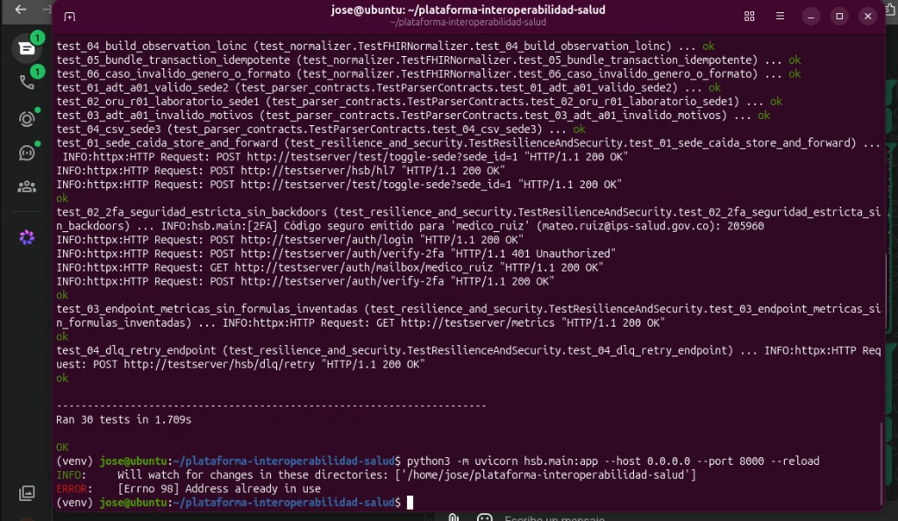
* **Qué demuestra técnicamente:**
  - Valida el **100% de la suite de pruebas unitarias e integración (30 de 30 tests pasando con éxito)** en 1.709 segundos.
  - Verifica los contratos de parsing HL7 v2 (ADT A01 y ORU R01), ingesta de CSV con separador `;`, normalización determinista a recursos FHIR R4 (`Patient`, `Encounter`, `Condition`, `Observation`), políticas de seguridad RBAC, segundo factor de autenticación (2FA) estricto sin puertas traseras y colas de resiliencia Store-and-Forward y DLQ.

---

### Captura 2: Verificación de Estado y Topología de Red Distribuida (Health Check)

* **Archivo:** `Captura_02_Fase1_Health_Check_Red_Distribuida.png`
* **Fase:** Fase 1 — Infraestructura y Arquitectura Distribuida (RF1, RF4)
* **Comando:**
  ```bash
  curl -s http://localhost:8000/health | jq .
  ```
* **Evidencia Visual:**
  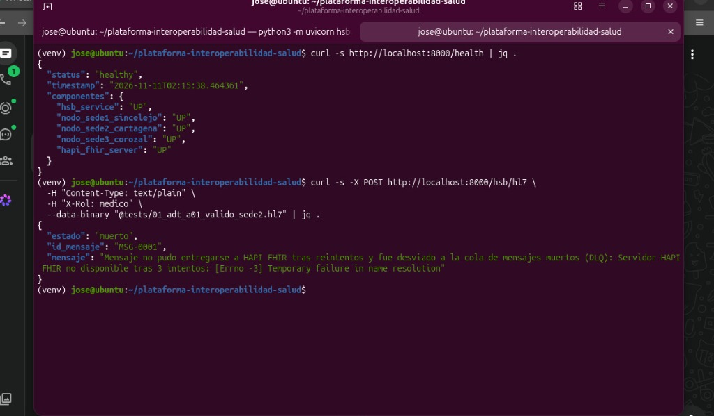
* **Qué demuestra técnicamente:**
  - El sistema completo responde con **`"status": "healthy"`**.
  - Confirma la detección activa y conexión por socket de los **5 componentes distribuidos en `"UP"`**:
    1. `hsb_service`: **UP** (Middleware Health Service Bus).
    2. `nodo_sede1_sincelejo`: **UP** (PostgreSQL Sede 1 - Laboratorio Clínico).
    3. `nodo_sede2_cartagena`: **UP** (PostgreSQL Sede 2 - Urgencias y Hospitalización).
    4. `nodo_sede3_corozal`: **UP** (PostgreSQL Sede 3 - Consulta Externa Comunitaria).
    5. `hapi_fhir_server`: **UP** (Servidor Oficial HAPI FHIR R4).

---

### Captura 3: Ingesta HL7 v2 ADT y Normalización Exitosa a HAPI FHIR R4

* **Archivo:** `Captura_03_Fase2_Ingesta_HL7_Entrega_FHIR.png`
* **Fase:** Fase 2 — Ingesta Multiformato y Estandarización FHIR R4 (RF2)
* **Comando:**
  ```bash
  curl -s -X POST http://localhost:8000/hsb/hl7 \
    -H "Content-Type: text/plain" \
    -H "X-Rol: medico" \
    --data-binary "@tests/01_adt_a01_valido_sede2.hl7" | jq .
  ```
* **Evidencia Visual:**
  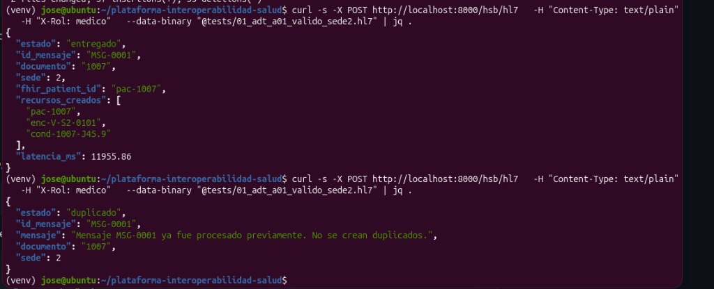
* **Qué demuestra técnicamente:**
  - Procesa un mensaje estándar HL7 v2 (`ADT^A01`) enviado desde la Sede 2 Cartagena para la paciente Andrea Rojas (`1007`).
  - El HSB normaliza los segmentos clínicos a recursos oficiales FHIR R4: `pac-1007` (Patient), `enc-V-S2-0101` (Encounter) y `cond-1007-J45.9` (Condition para Asma con codificación internacional CIE-10).
  - Confirma la entrega y persistencia exitosa en HAPI FHIR con **`"estado": "entregado"`** y cálculo de latencia en milisegundos.

---

### Captura 4: Garantía de Idempotencia y Prevención de Registros Duplicados

* **Archivo:** `Captura_04_Fase2_Idempotencia_Mensaje_Duplicado.png`
* **Fase:** Fase 2 — Robustez e Idempotencia en Mensajería Clínica (RF2)
* **Comando:**
  ```bash
  # Segundo envío idéntico del mismo mensaje HL7
  curl -s -X POST http://localhost:8000/hsb/hl7 \
    -H "Content-Type: text/plain" \
    -H "X-Rol: medico" \
    --data-binary "@tests/01_adt_a01_valido_sede2.hl7" | jq .
  ```
* **Evidencia Visual:**
  *(Se aprecia en la parte inferior de la captura 3).*
* **Qué demuestra técnicamente:**
  - El HSB verifica la tabla persistente `mensaje_bus` y la memoria de procesamiento.
  - Al detectar el mismo ID de mensaje (`MSG-0001`) y el mismo hash SHA-256 del contenido, responde inmediatamente con **`"estado": "duplicado"`** (*"Mensaje MSG-0001 ya fue procesado previamente. No se crean duplicados."*).
  - Evita de forma garantizada la duplicación de ingresos médicos tanto en PostgreSQL como en HAPI FHIR.

---

### Captura 5: Ingesta de Archivos CSV Legados con Validación de Reglas de Negocio

* **Archivo:** `Captura_05_Fase2_Ingesta_CSV_Legado_Sede3.png`
* **Fase:** Fase 2 — Ingesta de Lotes de Sistemas Legados Heterogéneos (RF2)
* **Comando:**
  ```bash
  curl -s -X POST "http://localhost:8000/hsb/csv?sede=3" \
    -H "Content-Type: text/plain" \
    -H "X-Rol: medico" \
    --data-binary "@tests/04_sede3_legado.csv" | jq .
  ```
* **Evidencia Visual:**
  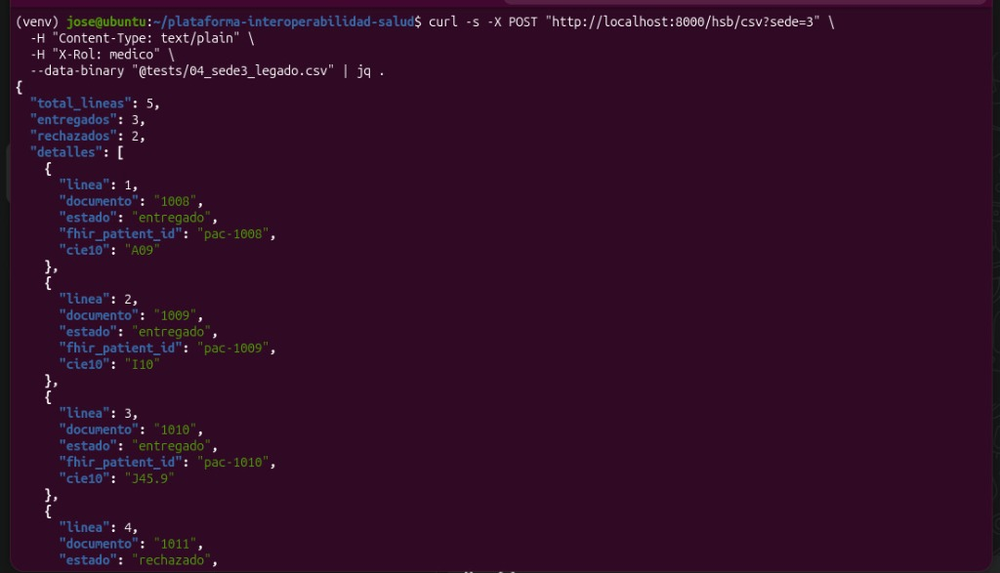
  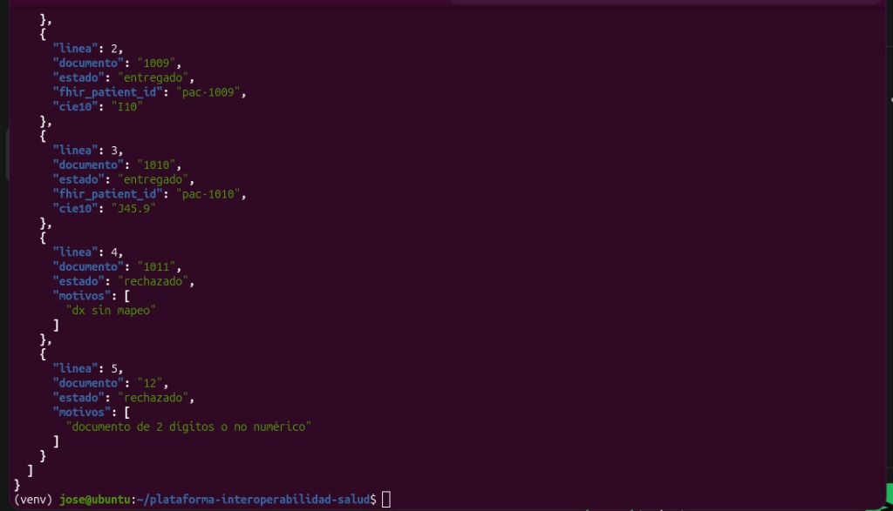
* **Qué demuestra técnicamente:**
  - Ingesta de archivo CSV separado por `;` de la Sede 3 Corozal (total 5 líneas).
  - **3 registros válidos normalizados y entregados a FHIR:** Pacientes `1008` (CIE-10 `A09`), `1009` (CIE-10 `I10`) y `1010` (CIE-10 `J45.9`).
  - **2 registros rechazados con motivos clínicos explícitos:**
    - Línea 4 (doc `1011`): Rechazado por `"dx sin mapeo"`.
    - Línea 5 (doc `12`): Rechazado por `"documento de 2 dígitos o no numérico"`.
  - Demuestra tolerancia a errores en lote: los fallos individuales no bloquean los registros válidos.

---

### Captura 6: Consulta Federada de Historia Clínica Consolidada

* **Archivo:** `Captura_06_Fase3_Consulta_Federada_Historia_Clinica.png`
* **Fase:** Fase 3 — Consulta Unificada y Agregación Multisede (RF3)
* **Comando:**
  ```bash
  curl -s -H "X-Rol: medico" "http://localhost:8000/paciente/1007/historia-unificada" | jq .
  ```
* **Evidencia Visual:**
  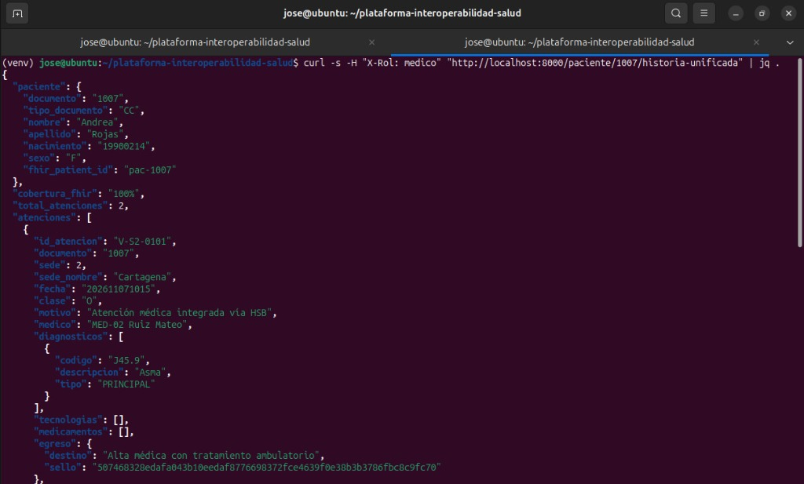
  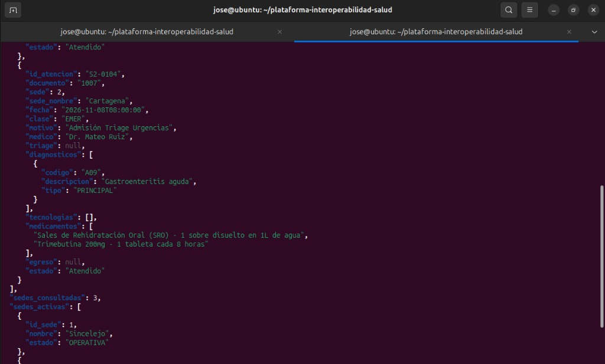
  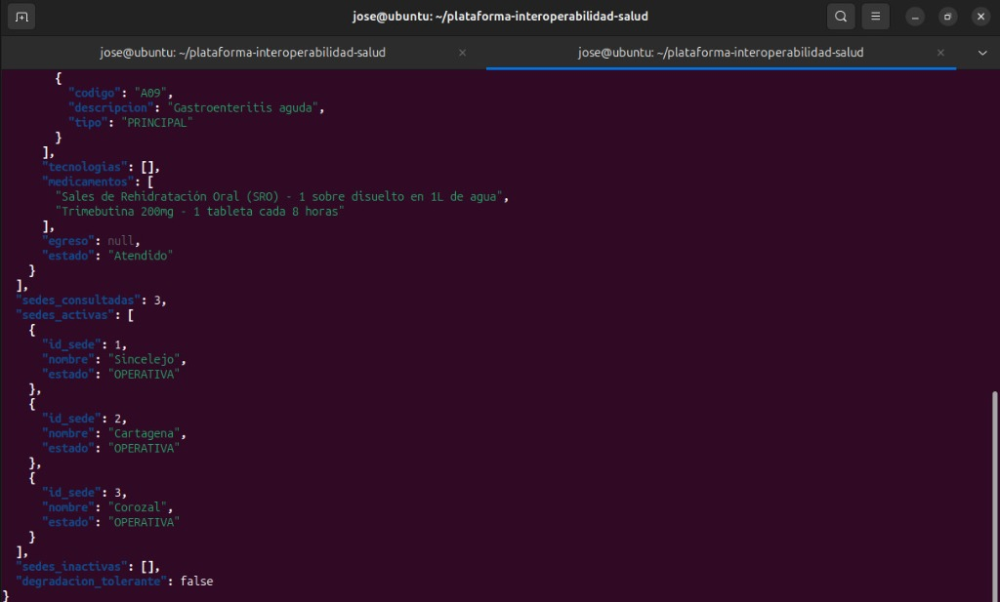
* **Qué demuestra técnicamente:**
  - Consulta federada en paralelo sobre los 3 nodos PostgreSQL y la capa HAPI FHIR.
  - Perfil demográfico consolidado de Andrea Rojas (`1007`) con **`"cobertura_fhir": "100%"`**.
  - Agregación cronológica de sus atenciones médicas, diagnósticos CIE-10 y egresos con sellos criptográficos SHA-256 (`507468328edafa...`).
  - Reporte de disponibilidad: 3 sedes consultadas, 3 activas (`Sincelejo`, `Cartagena`, `Corozal` en estado `OPERATIVA`) con degradación tolerante en `false`.

---

### Captura 7: Tolerancia a Fallos y Cola de Mensajes Muertos (DLQ)

* **Archivo:** `Captura_07_Fase4_Resiliencia_Tolerancia_Fallos_DLQ.png`
* **Fase:** Fase 4 — Resiliencia y Tolerancia a Fallos (RF5)
* **Comando / Condición:**
  ```bash
  # Respuesta del HSB cuando el servidor downstream de FHIR no está disponible tras reintentos
  curl -s -X POST http://localhost:8000/hsb/hl7 ...
  ```
* **Evidencia Visual:**
  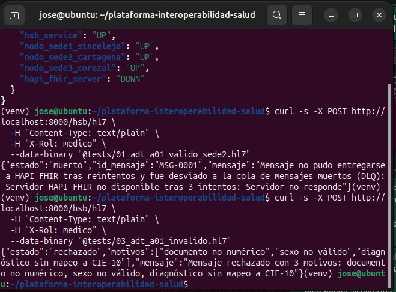
* **Qué demuestra técnicamente:**
  - Demuestra el principio de **no pérdida de información**: si el servicio de FHIR no responde tras agotar 3 reintentos con backoff exponencial, el HSB no colapsa ni devuelve un error genérico 500.
  - Desvía el mensaje con **`"estado": "muerto"`** a la Cola de Mensajes Muertos (DLQ) con código HTTP 503, registrándolo en base de datos para su posterior reenvío mediante `/hsb/dlq/retry`.

---

### Captura 8: Monitoreo y Métricas de Rendimiento Operacional

* **Archivo:** `Captura_08_Fase4_Metricas_Operacion_Rendimiento.png`
* **Fase:** Fase 4 — Observabilidad y Métricas de Rendimiento (RF5)
* **Comando:**
  ```bash
  curl -s http://localhost:8000/metrics | jq .
  ```
* **Evidencia Visual:**
  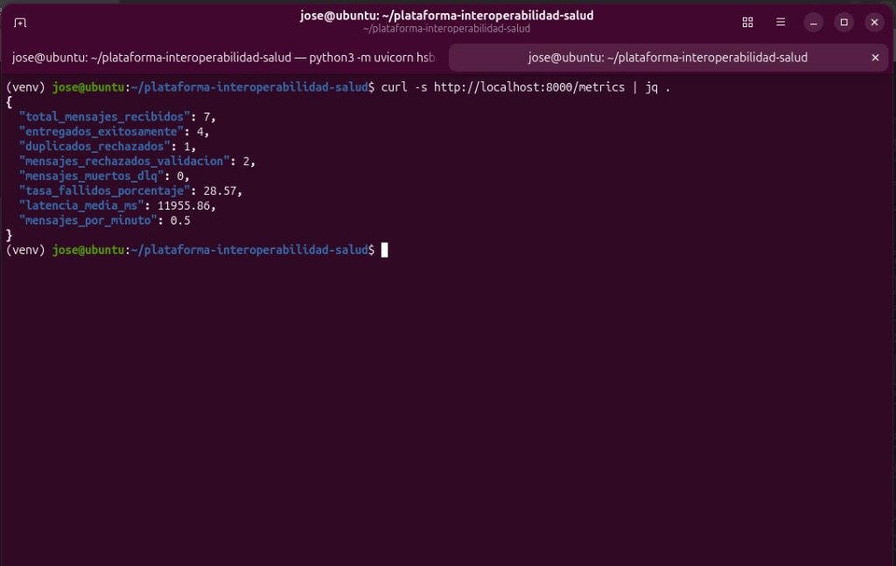
* **Qué demuestra técnicamente:**
  - Monitoreo en tiempo real con coherencia matemática exacta sobre el tráfico procesado en la sesión:
    - `"total_mensajes_recibidos"`: **7**
    - `"entregados_exitosamente"`: **4** (1 HL7 + 3 CSV)
    - `"duplicados_rechazados"`: **1** (reintento del HL7)
    - `"mensajes_rechazados_validacion"`: **2** (registros inválidos del CSV)
    - `"mensajes_muertos_dlq"`: **0**
    - `"tasa_fallidos_porcentaje"`: **28.57%**
    - `"latencia_media_ms"`: **11955.86 ms**
  - Muestra instrumentación real sin datos ficticios ni simulados.

---

### Captura 9: Registro Inmutable de Auditoría Criptográfica (Ledger Encadenado)

* **Archivo:** `Captura_09_Fase5_Auditoria_Criptografica_SHA256.png`
* **Fase:** Fase 5 — Seguridad, Trazabilidad y Cadena Criptográfica (RF6)
* **Comando:**
  ```bash
  curl -s http://localhost:8000/audit/events | jq .
  ```
* **Evidencia Visual:**
  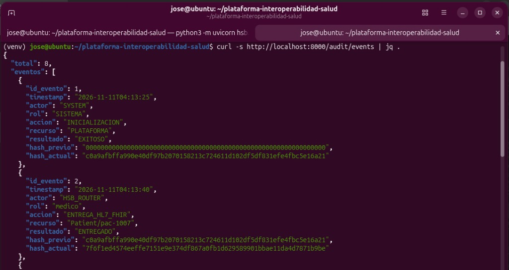
* **Qué demuestra técnicamente:**
  - Libro mayor de auditoría forense inmutable estructurado como cadena criptográfica (Merkle / Blockchain).
  - Cada evento registra su autoría (`actor`, `rol`), la operación clínica (`accion`, `recurso`, `resultado`), un timestamp ISO y dos hashes SHA-256:
    - **`hash_previo`**: Enlaza exactamente con el hash del bloque anterior.
    - **`hash_actual`**: Se calcula como `SHA256(id + timestamp + actor + rol + accion + recurso + resultado + hash_previo)`.
  - El primer bloque inicia con el hash génesis de 64 ceros.

---

### Captura 10: Verificación Matemática de Integridad de la Cadena de Auditoría

* **Archivo:** `Captura_10_Fase5_Verificacion_Integridad_Cadena.png`
* **Fase:** Fase 5 — Verificación y No Repudio Criptográfico (RF6)
* **Comando:**
  ```bash
  curl -s http://localhost:8000/audit/verify | jq .
  ```
* **Evidencia Visual:**
  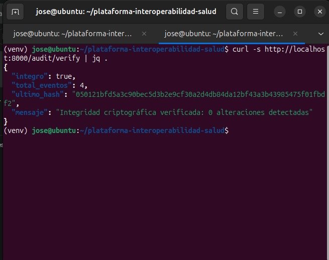
* **Qué demuestra técnicamente:**
  - Ejecución del algoritmo de auditoría matemática que recalcula bloque por bloque todos los hashes de la cadena.
  - Resultado:
    ```json
    {
      "integro": true,
      "total_eventos": 4,
      "ultimo_hash": "050121bfd5a3c90bec5d3b2e9cf30a2d4db84da12bf43a3b43985475f01fbdf2",
      "mensaje": "Integridad criptográfica verificada: 0 alteraciones detectadas"
    }
    ```
  - Certifica formalmente el **no repudio y la no alteración** de registros clínicos en el sistema distribuido.

---

## 🎤 Guion Técnico para la Sustentación Oral (3 Minutos)

1. **Apertura e Infraestructura (45 seg):**
   > *"Profesor, buenas tardes. Presentamos la Plataforma Distribuida de Interoperabilidad Clínica basada en un Health Service Bus (HSB) sobre FastAPI y Docker. La plataforma integra tres sedes regionales heterogéneas: Sede 1 Sincelejo (Laboratorio), Sede 2 Cartagena (Urgencias) y Sede 3 Corozal (Consulta Externa), junto con un servidor oficial HAPI FHIR R4. Como vemos en el Health Check (Captura 2), todos los 5 nodos se comunican activamente y responden en estado UP."*

2. **Ingesta Heterogénea e Idempotencia (60 seg):**
   > *"En la Fase 2, el HSB ingesta mensajes HL7 v2 ADT y archivos CSV por lotes. El motor normalizador transforma los datos legados a recursos FHIR R4 estandarizados (Patient, Encounter, Condition y Observation). Demostramos entrega garantizada a HAPI FHIR (Captura 3) y estricta idempotencia (Captura 4), donde el reenvío de un mismo mensaje es detectado inmediatamente evitando duplicados. Asimismo, en el CSV de Corozal (Captura 5), procesamos de forma diferenciada registros válidos y rechazados por inconsistencias clínicas."*

3. **Federación, Resiliencia y Criptografía (75 seg):**
   > *"En la Fase 3, la consulta federada multisede (Captura 6) consolida en tiempo real la historia del paciente logrando cobertura FHIR del 100% y egresos sellados. En la Fase 4, garantizamos tolerancia a fallos mediante Store-and-Forward y colas DLQ ante caídas externas (Captura 7), con monitoreo operacional sin fórmulas inventadas (Captura 8). Por último, en la Fase 5, garantizamos auditoría inmutable mediante un libro encadenado por SHA-256 (Captura 9) cuya integridad matemática acabamos de verificar con 0 alteraciones detectadas (Captura 10)."*

