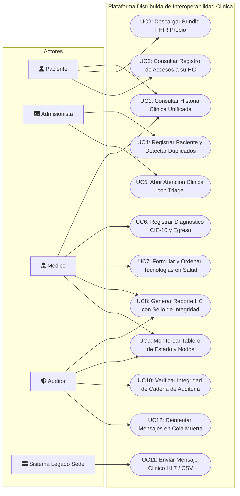
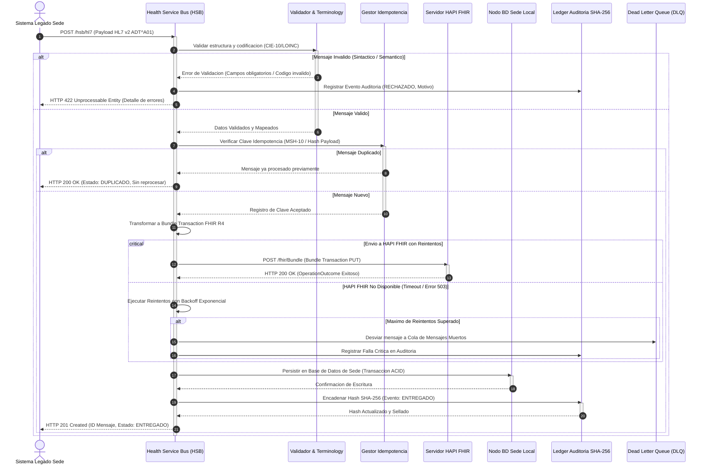
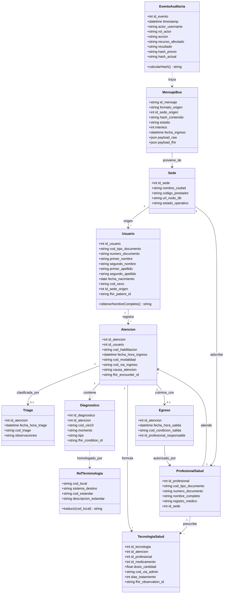
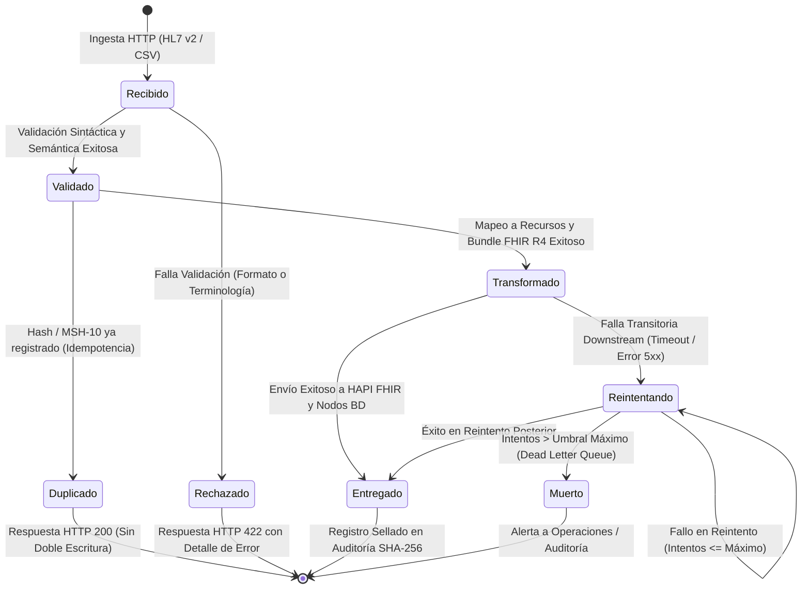

# Plataforma Distribuida de Interoperabilidad Clínica para una Red de IPS Federada

---

## 1. Título, Autores y Resumen

**Título del Proyecto (13 palabras):**  
*Plataforma Distribuida de Interoperabilidad Clínica para Unificación de Historias Clínicas en Redes Federadas*

**Autores:**  
- Estudiante 1 (Ingeniería de Sistemas)  
- Estudiante 2 (Ingeniería de Sistemas)  
*Docente:* Ing. Jaider Reyes Herazo  
*Asignatura:* Sistemas Distribuidos — Universidad Antonio José de Sucre (UAJS)

---

### Resumen (Conteo: 218 palabras)
Este proyecto diseña e implementa una plataforma distribuida de interoperabilidad clínica para una red de Instituciones Prestadoras de Salud (IPS) distribuida en tres sedes regionales: Sincelejo, Cartagena y Corozal. Cada sede opera con un sistema de información clínico legado autónomo, persistiendo datos en esquemas relacionales independientes y emitiendo registros en formatos heterogéneos (mensajes HL7 v2 ADT^A01/ORU^R01 y archivos planos CSV). Para mitigar la fragmentación de la historia clínica sin sustituir la infraestructura existente, se formula una arquitectura distribuida sustentada en un Bus de Servicios de Salud (HSB) desarrollado con FastAPI, un servidor central HAPI FHIR R4 y un clúster de almacenamiento distribuido (PostgreSQL con particionamiento federado/Citus). El HSB orquesta la ingesta multiformato, validación semántica con mapeo CIE-10/LOINC, normalización a recursos FHIR (*Patient*, *Encounter*, *Condition*, *Observation*) empaquetados en *Bundles* transaccionales idempotentes, y tolerancia a fallos mediante colas asíncronas de reintento y mensajes muertos (*Dead Letter Queue*). La seguridad se rige por control de acceso basado en roles (RBAC) mediante tokens JWT y una cadena de auditoría inmutable vinculada por hashes criptográficos SHA-256. El sistema garantiza la continuidad operativa bajo particionamiento parcial de red, degradando de forma controlada sin interrumpir la consulta unificada, cumpliendo las directrices de interoperabilidad técnica y semántica en salud.

---

## 2. Introducción y Objetivos

### 2.1. Introducción y Planteamiento del Problema
En los sistemas de salud regionales, la atención médica de los pacientes suele dispersarse a lo largo de múltiples centros de atención médica. En la red de IPS conformada por las sedes de Sincelejo, Cartagena y Corozal, cada institución ha implementado sistemas legados con bases de datos relacionales locales y formatos de intercambio divergentes: la sede de Cartagena emite admisiones de urgencias en mensajería estándar HL7 v2 (ADT^A01), Sincelejo genera reportes de laboratorio clínico ambulatorio en HL7 v2 (ORU^R01), mientras que Corozal persiste y exporta registros en archivos estructurados CSV con codificaciones clínicas propietarias.

Esta heterogeneidad tecnológica produce una severa **fragmentación de la historia clínica**:
1. **Riesgo asistencial:** Los facultativos carecen de una visión consolidada e integral de los antecedentes, diagnósticos previos y tratamientos prescritos en otras sedes.
2. **Incompatibilidad sintáctica y semántica:** No existe un modelo de datos común que homologue diagnósticos locales hacia vocabularios normalizados (CIE-10 para afecciones clínicas y LOINC para pruebas diagnósticas).
3. **Puntos únicos de fallo y falta de resiliencia:** Si la comunicación con una sede remota se degrada o colapsa, las consultas clínicas integrales se bloquean por completo si no existe una arquitectura federada con tolerancia a fallos parciales.
4. **Falta de trazabilidad auditable e inmutable:** La dispersión de registros dificulta auditar quién, cuándo y con qué motivo accedió a la información del paciente, contraviniendo marcos normativos como la Ley de Protección de Datos (Ley 1581 de 2012) y los lineamientos de interoperabilidad en salud de Colombia.

Para abordar este reto sin incurrir en los desmesurados costos de sustitución de los sistemas legados, se propone el desarrollo de una **Plataforma Distribuida de Interoperabilidad Clínica** basada en el estándar internacional **HL7 FHIR R4**, un **Health Service Bus (HSB)** desacoplado con colas de mensajería tolerantes a fallos, y mecanismos criptográficos de auditoría encadenada.

---

### 2.2. Objetivos

#### Objetivo General
Diseñar, implementar y desplegar una plataforma distribuida de interoperabilidad clínica que unifique la historia clínica fraccionada entre tres sedes hospitalarias (Sincelejo, Cartagena y Corozal) mediante un bus de servicios de salud (HSB), normalización a estándar HL7 FHIR R4 y almacenamiento distribuido resiliente con verificación de integridad criptográfica.

#### Objetivos Específicos (Medibles)
1. **Normalización y Estandarización Semántica:** Implementar un servicio de transformación e ingestión capaz de procesar el 100% de los mensajes sintéticos válidos en formatos HL7 v2 (ADT^A01 y ORU^R01) y CSV, normalizándolos a *Bundles* transaccionales FHIR R4 conformados por recursos *Patient*, *Encounter*, *Condition* (CIE-10) y *Observation* (LOINC) validados formalmente contra un servidor HAPI FHIR sin errores de esquema.
2. **Orquestación con Idempotencia y Tolerancia a Fallos:** Construir un Bus de Servicios de Salud (HSB) con mecanismos de deduplicación que garantice un 0% de registros duplicados ante reenvíos idénticos (idempotencia) y una política de reintentos exponenciales con cola de mensajes muertos (*Dead Letter Queue*) capaz de recuperarse automáticamente tras la caída transitoria de los servicios destino.
3. **Persistencia Distribuida y Resiliencia Operativa:** Desplegar una capa de almacenamiento distribuida (tres nodos de bases de datos relacionales por sede / clúster Citus) y un middleware federado que responda consultas unificadas en menos de 800 ms en condiciones normales, y mantenga disponible la consulta de sedes activas aun cuando una de las sedes experimente una falla total del nodo (fallo parcial).
4. **Seguridad y Confianza Criptográfica:** Establecer un control de acceso basado en roles (RBAC) con tokens JWT para cuatro perfiles de usuario (*Paciente, Admisionista, Médico, Auditor*) e implementar una bitácora de eventos clínicos encadenada por hashes SHA-256 capaz de detectar con un 100% de efectividad cualquier manipulación o inserción no autorizada en los registros de auditoría.

---

## 3. Marco Teórico y Conceptual

### 3.1. Marco Teórico

#### 1. Sistemas Distribuidos, Transparencia y Fallos Parciales
Un sistema distribuido es una colección de entidades computacionales autónomas conectadas mediante una red que cooperan para lograr un objetivo común, presentándose ante los usuarios como un único sistema coherente (Coulouris et al., 2012). En salud, una propiedad crítica es la **tolerancia a fallos parciales**: la falla de un componente o nodo de una sede regional no debe provocar el colapso de la plataforma completa. La plataforma debe ofrecer **transparencia de acceso y de ubicación**, permitiendo que los profesionales consulten registros clínicos sin conocer la dirección física del nodo que los custodia.

#### 2. Teorema CAP y Propiedades ACID
El Teorema de Eric Brewer (CAP) postula que en cualquier sistema de datos distribuido sujeto a particionamiento de red ($P$), solo es posible garantizar simultáneamente dos de tres propiedades: Consistencia ($C$) o Disponibilidad ($A$).
- En nuestra plataforma, cada sede preserva internamente propiedades **ACID** (Atomicidad, Consistencia, Aislamiento y Durabilidad) para garantizar la inmutabilidad de sus historias locales.
- Frente a la red distribuida, el sistema adopta una estrategia orientada a **Disponibilidad y Tolerancia al Particionamiento (AP)** con **consistencia eventual**: si una sede se desconecta, la consulta unificada no se aborta, sino que retorna los datos de las sedes disponibles marcando la sede inalcanzable con degradación elegante. Al restablecerse el nodo, la cola del HSB retransmite los mensajes pendientes.

#### 3. Interoperabilidad en Salud y Estándares
La interoperabilidad en salud se estructura en tres niveles esenciales (Heubusch, 2006):
- **Técnica:** Transporte confiable de flujos de bytes (HTTP/REST, TCP, MLLP).
- **Sintáctica:** Formatos estandarizados de estructura de datos (delimitadores HL7 v2 `|`, `^`, o documentos XML/JSON).
- **Semántica:** Comprensión inequívoca del significado clínico mediante ontologías y terminologías universales.

#### 4. HL7 v2 frente a HL7 FHIR R4
- **HL7 v2:** Estándar de mensajería transaccional basado en texto delimitado por barras verticales (`|`) y signos de intercalación (`^`). Se divide en segmentos estructurales como `MSH` (encabezado del mensaje), `PID` (datos demográficos del paciente), `PV1` (visita clínica), `DG1` (diagnósticos) y `OBR`/`OBX` (órdenes y resultados de observación). Es el estándar dominante en sistemas legados hospitalarios.
- **HL7 FHIR R4 (*Fast Healthcare Interoperability Resources*):** Estándar contemporáneo de interoperabilidad basado en tecnologías web abiertas (JSON/XML, APIs RESTful, HTTP status codes). Modela la información clínica en componentes discretos denominados *Recursos* interconectados mediante referencias URI.

#### 5. Bus de Integración de Salud (HSB) e Idempotencia
Un Bus de Servicios de Salud (*Health Service Bus*) actúa como middleware de mediación que desacopla a los emisores de los receptores clínicos. Realiza funciones de enrutamiento dinámico, enriquecimiento, validación sintáctica/semántica y mediación de protocolos. La **idempotencia** es la propiedad de una operación que, ejecutada $N$ veces consecutivas con los mismos parámetros de entrada, genera exactamente el mismo efecto en el estado del sistema que si se ejecutase una sola vez ($f(f(x)) = f(x)$). En el HSB, se garantiza asociando el identificador único del mensaje (`MSH-10`) o un hash criptográfico de su payload para rechazar duplicados en la capa de ingesta.

---

### 3.2. Marco Conceptual
- **Recurso FHIR:** Entidad de información básica indivisible que representa un concepto de salud identificable (ej. `Patient`, `Observation`, `Encounter`, `Condition`).
- **Perfil FHIR (*Profile*):** Restricción y extensión formal sobre un recurso base para adaptarlo a un contexto normativo o asistencial específico (ej. exigir documento de identidad obligatorio).
- **Bundle FHIR:** Colección empaquetada de recursos clínicos bajo un único contenedor JSON. Puede ser de tipo `searchset`, `document` o `transaction` (ejecuta un conjunto atómico de operaciones HTTP PUT/POST en el servidor).
- **Terminología Clínica:** Sistemas de codificación estándar:
  - **CIE-10 (Clasificación Internacional de Enfermedades):** Codificación alfanumérica de morbilidades diagnósticas (ej. `J45.9` - Asma, `I10` - Hipertensión).
  - **LOINC (*Logical Observation Identifiers Names and Codes*):** Codificación universal de resultados de laboratorio y pruebas diagnósticas (ej. `718-7` - Hemoglobina en sangre total).
- **API RESTful:** Interfaz basada en verbos HTTP (`GET`, `POST`, `PUT`, `DELETE`) con recursos identificables mediante URIs y comunicación sin estado (*stateless*).
- **Hash Criptográfico SHA-256:** Algoritmo unidireccional que produce una huella digital determinista de 256 bits a partir de cualquier dato de entrada. En la auditoría encadenada, el hash del evento actual incluye el hash del evento predecesor ($H_n = \text{SHA256}(D_n + H_{n-1})$), creando una cadena a prueba de manipulaciones (*tamper-evident log*).

---

## 4. Arquitectura del Sistema y Justificación de Componentes

### 4.1. Diagrama de Arquitectura Global

```
+---------------------------------------------------------------------------------------------------------+
|                                    CAPA DE PRESENTACIÓN / VISTAS                                        |
|  [Vista Paciente]        [Vista Admisionista]          [Vista Médico]         [Vista Reporte HC / Tablero] |
+---------------------------------------------------------------------------------------------------------+
                                                     | HTTP / REST (JWT Bearer Token)
                                                     v
+---------------------------------------------------------------------------------------------------------+
|                              CAPA DE MEDIACIÓN Y NEGOCIO: HSB / MIDDLEWARE                              |
|                                                                                                         |
|  +--------------------+   +-----------------------+   +----------------------+   +-------------------+  |
|  | Puertas de Ingesta |-->| Validador Sintáctico  |-->| Normalizador FHIR R4 |-->| Motor Idempotente |  |
|  | /hsb/hl7  /hsb/csv |   | y Reglas de Negocio   |   | (CIE-10 / LOINC)      |   | (Hash / MSH-10)   |  |
|  +--------------------+   +-----------------------+   +----------------------+   +-------------------+  |
|                                                                                            |            |
|  +--------------------+   +-----------------------+   +----------------------+             |            |
|  | Observabilidad     |   | RBAC Security Engine  |   | Gestor de Reintentos |<------------+            |
|  | /health & /metrics |   | (Auth JWT / 4 Roles)  |   | y Cola Dead-Letter   |                          |
|  +--------------------+   +-----------------------+   +----------------------+                          |
+---------------------------------------------------------------------------------------------------------+
                    |                                     |                              |
      Sincronización| FHIR Transaction                    | SQL Distribuido              | Eventos SHA-256
                    v                                     v                              v
        +-----------------------+             +-----------------------+      +-----------------------+
        |   Servidor HAPI FHIR  |             |  Almacén Distribuido  |      | Auditoría Encadenada  |
        |      (Puerto 8090)    |             |  Nodos PostgreSQL     |      |  (Tamper-Evident Log) |
        +-----------------------+             +-----------------------+      +-----------------------+
                                              | Sede 1: Sincelejo     |
                                              | Sede 2: Cartagena     |
                                              | Sede 3: Corozal       |
                                              +-----------------------+
```

---

### 4.2. Matriz de Justificación Arquitectónica: Requisitos vs. Componentes

| Requisito | Componente Arquitectónico | Justificación Técnica de Diseño |
| :--- | :--- | :--- |
| **RF1: Ingesta Multiformato** | Adaptadores de entrada `/hsb/hl7` y `/hsb/csv` | Procesa en el punto de contacto mensajes HL7 v2 (segmentos `MSH`, `PID`, `PV1`, `DG1`, `OBX`) y archivos CSV tabulares sin exigir cambios en las sedes emisoras. |
| **RF2: Normalización FHIR R4** | Módulo Normalizador FHIR + Catálogos CIE-10/LOINC | Mapea registros locales hacia esquemas estandarizados HL7 FHIR (`Patient`, `Encounter`, `Condition`, `Observation`) empaquetados en un `Bundle` transaction atómico. |
| **RF3: Enrutamiento, Idempotencia y Reintentos** | Motor de Idempotencia + Gestor de Colas Asíncronas con DLQ | Calcula un hash único de mensaje (`MSH-10` o SHA-256 de payload) para evitar duplicados en base de datos. Implementa reintentos con backoff exponencial y desvío a Dead Letter Queue si el destino falla. |
| **RF4: Datos Distribuidos y Consulta Unificada** | 3 Nodos PostgreSQL por Sede + Middleware Coordinador | Permite la federación de bases de datos locales independientes. El middleware ejecuta consultas concurrentes contra las sedes, fusiona la historia clínica por documento de identidad y soporta particionamiento. |
| **RF5: Seguridad y Auditoría Criptográfica** | Middleware de Autenticación JWT + Ledger de Auditoría SHA-256 | Aplica control de acceso RBAC para 4 roles. Cada transacción clínica se sella encadenando el hash del evento anterior, garantizando trazabilidad y detección inmediata de alteraciones de registros. |
| **RF6: Cuatro Vistas Especializadas** | Frontend Web Modular con Dashboard de Estado | Proporciona interfaces orientadas a las tareas de cada perfil (*Paciente, Admisionista, Médico, Auditor*) y monitorea en tiempo real la salud de los nodos y la cobertura de migración FHIR. |
| **RNF: Despliegue Unificado** | Orquestación `docker compose up` | Todo el ecosistema (Postgres por sede, HAPI FHIR, HSB y Frontend) se aprovisiona automáticamente con redes y volúmenes aislados sin configuración manual. |
| **RNF: Tolerancia a Fallos Parciales** | Manejo de Timeouts y Degradación Elegante en el HSB | Si una sede cae (`docker stop pg_sede2`), la consulta unificada no arroja error 500: retorna la información de las sedes operativas y marca la sede caída en el tablero. |
| **RNF: Observabilidad** | Endpoints `/health` y `/metrics` en el HSB | Expone métricas clave en formato estándar (latencia promedio, mensajes/min, tasa de fallos, estado de salud de cada conexión downstream). |

---

## 5. Modelado UML Completo

### 5.1. Diagrama de Casos de Uso
El sistema involucra cinco actores: cuatro humanos (**Paciente**, **Admisionista**, **Médico**, **Auditor de Calidad**) y un actor de infraestructura (**Sistema Legado de Sede**).



---

### 5.2. Diagrama de Secuencia: Ingesta de Mensaje HL7 v2 y Transformación a FHIR
Ilustra el procesamiento de extremo a extremo de un mensaje clínico, incluyendo la verificación de idempotencia, el camino exitoso de persistencia/publicación y el camino de fallo con reintentos y cola de mensajes muertos.



---

### 5.3. Diagrama de Clases: Modelo de Dominio y Entidades del Sistema
Estructura de las 11 entidades de negocio, incluyendo persistencia relacional, componentes de auditoría y estructuras de mensajería distribuida.



---

### 5.4. Diagrama de Máquina de Estados del Mensaje en el HSB
Representa el ciclo de vida de un mensaje clínico en el bus de interoperabilidad desde su recepción hasta su entrega final, reintentos o confinamiento en la cola de mensajes muertos.



---

### 5.5. Reglas de Validación de Estados y Transiciones

| Estado Inicial | Transición / Evento | Estado Final | Regla de Negocio / Condición de Guarda |
| :--- | :--- | :--- | :--- |
| `[Inicio]` | Ingesta HTTP | `Recibido` | El payload contiene texto plano no vacío y headers válidos. |
| `Recibido` | Validación sintáctica | `Rechazado` | Faltan campos obligatorios (`PID-3`, `PV1-2`) o tipo de documento no numérico. |
| `Recibido` | Validación semántica | `Rechazado` | El diagnóstico o código no existe en `ref_terminologia` y no es CIE-10 válido. |
| `Recibido` | Validación correcta | `Validado` | Supera validación de formato, campos mínimos y codificación clínica. |
| `Validado` | Consulta de Idempotencia | `Duplicado` | El identificador de mensaje o hash SHA-256 ya existe en `mensaje_bus`. |
| `Validado` | Consulta de Idempotencia | `Transformado` | Mensaje inédito. Se genera el Bundle FHIR R4 con IDs deterministas. |
| `Transformado` | Envío a HAPI / BD | `Entregado` | Servidor FHIR responde HTTP 200/201 y la base de datos local confirma el commit. |
| `Transformado` | Error de Red / Downstream | `Reintentando` | Excepción de conexión o código HTTP $\ge 500$; contador de intentos $< 3$. |
| `Reintentando` | Espera de Backoff | `Transformado` | Intervalo de espera exponencial completado ($2^n \times 1\text{ s}$). |
| `Reintentando` | Exceder reintentos | `Muerto` | Contador de reintentos $> 3$. Se mueve el payload a la Dead Letter Queue (DLQ). |

---

## 6. Mapeo de Campos de Origen a Recursos FHIR R4 (Mínimo 15 Campos)

La siguiente tabla define formalmente la especificación de transformación de datos heterogéneos (HL7 v2 y CSV legado) hacia los recursos del estándar internacional HL7 FHIR R4:

| No. | Campo Origen (HL7 v2 / CSV) | Descripción Clínica | Recurso FHIR R4 Destino | Elemento / Atributo FHIR R4 | Tipo de Dato FHIR | Regla de Transformación / Mapeo |
| :---: | :--- | :--- | :--- | :--- | :--- | :--- |
| **1** | `PID-3` / `documento` | Número de Identificación | `Patient` | `Patient.identifier.value` | `string` | Se normaliza a dígitos sin puntos ni guiones. |
| **2** | `PID-3.4` / Sistema | Tipo de Documento | `Patient` | `Patient.identifier.system` | `uri` | Se asigna URI oficial: `https://minsalud.gov.co/id/cc`. |
| **3** | `PID-5.1` / Apellido | Primer Apellido | `Patient` | `Patient.name.family` | `string` | Extracción de apellido paterno en mayúsculas. |
| **4** | `PID-5.2` / Nombre | Nombres de Pila | `Patient` | `Patient.name.given[0]` | `string` | Extracción de nombres de pila. |
| **5** | `PID-7` / `nacimiento` | Fecha de Nacimiento | `Patient` | `Patient.birthDate` | `date` | Conversión de formato `YYYYMMDD` o `YYYY-MM-DD` a ISO 8601 `YYYY-MM-DD`. |
| **6** | `PID-8` / `sexo` | Sexo Biológico | `Patient` | `Patient.gender` | `code` | Mapeo terminológico: `M` $\to$ `male`, `F` $\to$ `female`, `O` $\to$ `other`. |
| **7** | `MSH-4` / Sede Origen | Organización de Origen | `Patient` / `Encounter` | `*.serviceProvider.display` | `string` | Nombre institucional de la sede (Sincelejo, Cartagena, Corozal). |
| **8** | `PV1-19` / Id Visita | Identificador de Encuentro | `Encounter` | `Encounter.identifier.value` | `string` | Prefijo determinista por sede: ej. `ENC-S2-0101`. |
| **9** | `PV1-2` / `triage` | Clase de la Atención | `Encounter` | `Encounter.class.code` | `code` | Mapeo: `E` $\to$ `EMER` (Urgencia), `O` $\to$ `AMB` (Ambulatorio), `I` $\to$ `IMP` (Hospitalario). |
| **10** | `PV1-44` / `fecha` | Fecha/Hora de Ingreso | `Encounter` | `Encounter.period.start` | `dateTime` | Formateo a timestamp ISO 8601 con zona horaria colombiana (`-05:00`). |
| **11** | `PV1-7` / `profesional` | Médico Responsable | `Encounter` | `Encounter.participant.individual.display`| `string` | Nombre y registro del profesional médico tratante. |
| **12** | `DG1-3.1` / `dx_local` | Código Diagnóstico | `Condition` | `Condition.code.coding.code` | `code` | Código CIE-10 validado y homologado (ej. `J45.9`). |
| **13** | `DG1-3.2` / Descripción | Texto del Diagnóstico | `Condition` | `Condition.code.coding.display`| `string` | Descripción clínica oficial del CIE-10 (ej. *Asma no especificada*). |
| **14** | `DG1-3.3` / Sistema Dx | Sistema de Codificación | `Condition` | `Condition.code.coding.system` | `uri` | URI estándar internacional: `http://hl7.org/fhir/sid/icd-10`. |
| **15** | `OBR-4.1` / Código Lab | Código de Prueba Laboratorio | `Observation` | `Observation.code.coding.code`| `code` | Código LOINC universal (ej. `718-7`). |
| **16** | `OBR-4.2` / Nombre Lab | Nombre de la Prueba | `Observation` | `Observation.code.coding.display`| `string` | Descripción de la prueba (ej. *Hemoglobina en sangre total*). |
| **17** | `OBX-5` / Valor | Resultado Cuantitativo | `Observation` | `Observation.valueQuantity.value`| `decimal` | Valor numérico del resultado (ej. `13.8`). |
| **18** | `OBX-6` / Unidad | Unidad de Medida | `Observation` | `Observation.valueQuantity.unit` | `string` | Unidad estándar en UCUM (ej. `g/dL`). |
| **19** | Referencia Paciente | Asociación Paciente-Recurso | `Encounter` / `Condition` / `Observation` | `*.subject.reference` | `string` | Referencia relativa determinista interna: `Patient/pac-<documento>`. |
| **20** | Referencia Encuentro | Asociación Encuentro-Clínica | `Condition` / `Observation` | `*.encounter.reference` | `string` | Referencia relativa: `Encounter/enc-<id_visita>`. |

---

## 7. Justificación Metodológica y Hoja de Ruta para las Siguientes Fases

La arquitectura propuesta responde de manera rigurosa a las directrices de la asignatura y los requerimientos del parcial final:
1. **Fase 2 (Capa de Persistencia y Normalizador FHIR):** Se implementa la infraestructura de tres contenedores PostgreSQL independientes representando las sedes de Sincelejo, Cartagena y Corozal con esquemas enriquecidos a partir de `schema_base.sql`, junto al despliegue del servidor HAPI FHIR oficial en Docker. Se construye el script normalizador en Python con validación atómica `Bundle` transaction PUT.
2. **Fase 3 (HSB y Mediación de Integración):** Desarrollo del middleware central en FastAPI con endpoints multiformato (`/hsb/hl7`, `/hsb/csv`), cola asíncrona de procesamiento con reintentos y desvío a DLQ, y memoria transaccional para idempotencia absoluta.
3. **Fase 4 (Seguridad, Auditoría Criptográfica y Resiliencia):** Implementación de autenticación JWT y RBAC con cuatro roles, bitácora de auditoría inmutable con cadena de hashes SHA-256 (`AuditEvent`), y algoritmo de consulta distribuida tolerante a particionamiento y fallos parciales.
4. **Fase 5 (Frontend Web y Sustentación):** Construcción de las 4 vistas accesibles por rol, tablero de control de cobertura y script de demostración integral automatizado con `docker compose up`.
